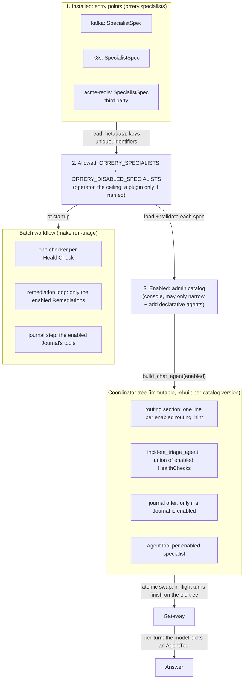

# ADR-005: How the coordinator's specialists are chosen

**Status:** Accepted
**Date:** 2026-10-17
**Author:** Taoufiq

## Context

"Which agent handles this?" is answered at two different times, by two
different mechanisms:

1. **Which specialists exist for this deployment**, decided before any question
   is asked: by what is installed, what the operator allows, and what an admin
   switched on in the console.
2. **Which specialist answers a given request**, decided per turn by the
   coordinator model, choosing among the specialists from step 1.

Until this ADR, step 1 was only half generic. Specialists registered through
entry points, but the coordinator still carried a table of facts about the
built-in ones: a routing line per agent name, the tools each contributes to a
health sweep, the batch workflow's five checkers and their report keys, the
remediation loop's Kubernetes and Kafka tools, and a fixed offer to save
findings in the ops journal. A third-party specialist routed on its
`description` alone, could never join a health sweep, and every new built-in
meant an edit to the coordinator. The fixed text also produced real bugs: the
sweep called tools of specialists that were switched off (#253), the journal
was offered after it was switched off (#255), and the batch loop could still
reach for `restart_deployment` with Kubernetes switched off.

## Decision

**A specialist declares what it contributes; the coordinator is assembled from
the declarations of the enabled specialists, and knows none by name.**

```python
specialist = SpecialistSpec(
    agent=root_agent,
    routing_hint="Kafka cluster health, topics, consumer groups, lag, ...",
    health_check=HealthCheck(
        system="Kafka", checks="...", criteria="...", tools=(get_kafka_cluster_health, ...)
    ),
    remediation=None,  # k8s: Remediation(actions=(restart_deployment, ...), playbook="...")
    journal=None,  # ops_journal: Journal(save=save_note, log=log_operation)
)
```

```toml
[project.entry-points."orrery.specialists"]
kafka = "kafka_health_agent.agent:specialist"
```

## The mechanism, end to end



### Step 1: which specialists exist

| Layer | Who decides | How | Can it widen the one above? |
|---|---|---|---|
| Installed | Whoever builds the image | Python entry points, group `orrery.specialists` | n/a |
| Allowed | The operator | `ORRERY_SPECIALISTS` / `ORRERY_DISABLED_SPECIALISTS`. Built-ins are allowed by default; a third-party specialist only when `ORRERY_SPECIALISTS` names it | No: an unknown name stops startup |
| Enabled | An admin, at run time | `PUT /admin/catalog` (console Agents tab) | No: switching on an env-excluded specialist is refused |

Each layer can only narrow the one above it, so nothing pinned in a deployment
can be undone from a browser. Installing is not trusting: a package in the
image, or one a dependency pulled in, contributes nothing until an operator
names it. Until then it is only *read* (its entry-point metadata), never
imported; the admin view lists it the same way. The catalog may also *add* declarative agents,
but those only recombine tools that installed specialists already expose, each
keeping its own guard level.

### Step 2: which specialist answers

The coordinator is a chat-mode `LlmAgent`. Each enabled specialist is wrapped as
an `AgentTool` (agents-as-tools; see ADR-002/003), and the instruction's routing
section lists one line per specialist: its `routing_hint`. The model picks the
tool. This step is probabilistic by design. It is kept honest by:

- a **closed world**: the routing section, the sweep and the journal offer are
  pure functions of the enabled set, so the coordinator is never told about a
  specialist it cannot call;
- **one owner per description**: the line the model routes on is written next
  to the specialist's tools, by the people who know them;
- **evals** (`make eval`) that score routing on real questions.

A broad "is everything healthy?" goes to `incident_triage_agent`, built from the
enabled specialists' `HealthCheck`s. The batch workflow (`make run-triage`)
builds one parallel checker per `HealthCheck` from the same declarations, so the
two sweeps cannot drift apart.

The batch workflow then acts only through declarations as well. Its remediation
actor holds the enabled specialists' `Remediation.actions`, guided by their
playbooks; its verifier holds their `verify` tools plus every enabled
health-check tool; its journal step holds the enabled `Journal`'s tools. With no
`Remediation` enabled (the Tirraflow lab runs Kafka and observability only)
there is no loop in the graph at all, and the report says a human must act.

## Patterns this follows

| Pattern | Where |
|---|---|
| Plugin architecture / microkernel (as pytest plugins, Flask extensions) | Entry points: a specialist is a `pip install`, not a fork |
| Self-describing components (cf. A2A Agent Cards, MCP tool descriptions) | `SpecialistSpec`: hint, health check, remediation, journal |
| Dependency inversion | The coordinator depends on the `orrery_core.registry` contract, never on a specialist package |
| Capability-based offers | `Journal`, `Remediation`: the coordinator offers and does what an enabled specialist declares, never by name |
| Least privilege / default deny | A third-party specialist is off until named; the loop holds only enabled, guarded actions |
| Layered, monotone configuration | install ⊇ env ⊇ catalog |
| Agents as tools vs workflow | LLM routing for chat; a deterministic graph for the batch sweep (ADR-003) |
| Validate by construction | The new tree is built before the catalog is saved; a failure changes nothing |
| Optimistic concurrency | Each save names its version; a stale one gets 409 (like Kubernetes `resourceVersion`) |
| Immutable snapshot + atomic swap | A new root replaces the old; turns in flight finish on the tree they started on |

## Security properties

- **Read-only sweeps, enforced at startup.** A `HealthCheck` (and a
  `Remediation.verify`) may only list tools that its own agent exposes, that
  carry no `@confirm`/`@destructive` guard, and that are not *named* as a write
  (an undecorated `restart_pod` would otherwise pass as a read). Sweeps run
  unattended: an instruction saying "take no action" is not a control, so a
  violation stops startup instead.
- **Every unattended action is gated.** `Remediation.actions` must be guarded,
  and the actor carries the confirmation gate, so on a run with nobody to
  answer, each action stops at "confirmation required".
- **Installing is not trusting.** A third-party specialist is loaded only when
  the operator names it. Two packages claiming one key stop startup, so none
  can quietly replace a built-in.
- **Plugins meet the built-ins' invariants at startup.** This repository's
  tests check that every agent with a guarded tool has a confirmation gate and
  that no tool named as a write is undecorated. A plugin never meets those
  tests, so the same two checks run on everything it can reach when it loads.
- **Specialist text cannot rewrite the coordinator's rules.** A routing hint
  or description enters the prompt as one line of at most 200 characters.
- **No privilege from the browser.** The catalog only narrows the env and
  composes reviewed tools. Editing needs the admin role *and* the deployment
  flag `ORRERY_ADMIN_EDITING` (off by default). Reading needs admin.
- **Guards travel with tools.** RBAC, the confirmation gate and autonomy
  levels read the tool's own decorator wherever the tool ends up: specialist,
  declarative agent or sweep.
- **Audited.** Every catalog save emits `agent_catalog_updated` with the
  actor, version and resulting set.

## Reliability properties

- **Fail fast on bad configuration.** An unknown specialist name, a duplicate
  or non-identifier key, an entry point that is neither an agent nor a spec, an
  invalid contribution, or two different tools under one name in an assembled
  agent stops startup with a message naming it.
- **Silence is not health.** The batch fallback reads every checker's report;
  an empty one is "degraded", and a run that checked no system exits
  "incomplete" (2), never "complete" (0).
- **The served tree is always one that built.** Build, then save, then swap.
  A stored catalog that no longer builds (a specialist was uninstalled) is
  logged and skipped; the current tree keeps serving.
- **No lost edits.** Concurrent admins get a conflict, not last-write-wins.
- **No torn turns.** Swapping the root never changes a turn already running.
  A thread's session survives the swap (`core/tests/test_session_continuity.py`).
- **Replicas converge.** Each polls the catalog version
  (`ORRERY_CATALOG_POLL_SECONDS`, default 15) when the store is Postgres.

## Consequences

- A new specialist, built-in or third party, is one package with one entry
  point. It routes, joins both sweeps, offers its remediation and its journal
  with no edit to the coordinator (a third-party one, once named in
  `ORRERY_SPECIALISTS`). `agents/orrery-assistant/tests/test_admin.py` proves it
  with a "redis" specialist the coordinator has never heard of.
- Entry points that name a bare agent still work: no contributions, routed by
  `description`.
- The routing line's quality now sits with the specialist's authors. A vague
  hint routes badly, which evals catch.
- **Known limits.** The batch workflow is built once, from the env, not
  from the admin catalog (it is a separate entry point that runs and exits).
  A plugin's toolsets (MCP, OpenAPI) only list their tools at run time, so the
  startup checks cannot see inside them; the confirmation gate still applies
  per tool when they run. A checker's state key is `<key>_status`, not
  namespaced.
- Without `DATABASE_URL`, catalog edits live in memory and reset on restart.
