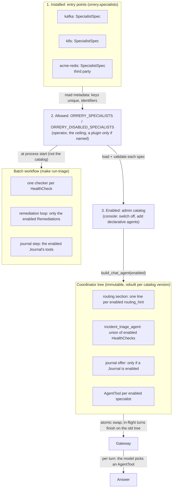

# How specialists are chosen

"Which agent handles this?" is answered at two different times, by two
different mechanisms:

1. **Which specialists exist for this deployment**, decided before any question
   is asked: by what is installed, what the operator allows, and what an admin
   switched on in the console.
2. **Which specialist answers a given request**, decided per turn by the
   coordinator model, choosing among the specialists from step 1.

This page describes both, what each guarantees, and where each stops. The
decision behind it, and the alternatives, are in
[ADR-005](adr/005-specialist-selection.md). How to write a specialist is in
[Adding a New Agent](adding-an-agent.md).

## What a specialist declares

A specialist is a package with one entry point. It names a `SpecialistSpec`:
the agent, and what it contributes to the rest of the platform.

```python
specialist = SpecialistSpec(
    agent=root_agent,
    routing_hint="Kubernetes cluster info, nodes, pods, deployments, ...",
    health_check=HealthCheck(
        system="Kubernetes",
        checks="...",
        criteria="...",
        tools=(get_cluster_info, get_nodes, get_events, list_pods),
    ),
    remediation=Remediation(
        actions=(restart_deployment, scale_deployment, rollback_deployment),
        playbook="...",
        verify=(get_deployment_status, list_pods, ...),
    ),
    journal=None,  # the ops journal declares Journal(save=save_note, log=log_operation)
    setup_check=SetupCheck(label="Kubernetes", tool=get_cluster_info, hint="..."),
)
```

```toml
[project.entry-points."orrery.specialists"]
k8s = "k8s_health_agent.agent:specialist"
```

| Contribution | What uses it |
|---|---|
| `routing_hint` | The coordinator's routing section: one line per enabled specialist |
| `health_check` | Both sweeps: the chat `incident_triage_agent` and the batch workflow's `<key>_health_checker` |
| `remediation` | The batch workflow's act → verify loop, which exists only if one is enabled |
| `journal` | The coordinator's "want me to save this?" offer, and the batch workflow's journal step |

The coordinator imports no specialist. Everything it says about one, and every
tool it reaches through one outside an `AgentTool`, comes from these
declarations.

## The mechanism, end to end



### Step 1: which specialists exist

| Layer | Who decides | How | Can it widen the one above? |
|---|---|---|---|
| Installed | Every distribution in the Python environment, transitive dependencies included | Entry points, group `orrery.specialists` | n/a |
| Allowed | The operator | `ORRERY_SPECIALISTS` / `ORRERY_DISABLED_SPECIALISTS`. Built-ins are allowed by default; a third-party specialist only when `ORRERY_SPECIALISTS` names it | No: an unknown name stops startup |
| Allowed tools | The operator | `ORRERY_DISABLED_TOOLS`: qualified `key.tool` names taken out of a running specialist | No: it only removes, and an unknown name stops startup |
| Enabled | An admin, at run time | `PUT /admin/catalog` (console Agents tab) | No: switching on an env-excluded specialist is refused |

The layers narrow. Two details matter:

- **"Switched off" in the catalog removes the route, not the tools.** The
  coordinator no longer delegates to that specialist and the sweep no longer
  checks it, but a declarative agent may still use its tools, each with its own
  guard level. This is deliberate: a narrow agent over a broad specialist's
  tools is a common reason to switch the broad one off. To take tools away
  entirely, exclude the specialist in the env, or a single tool with
  `ORRERY_DISABLED_TOOLS`.
- **A removed tool is gone from everything the orchestrator builds.**
  `ORRERY_DISABLED_TOOLS` clones the specialist's agent without the tool
  before anything is built from it, so the coordinator, declarative agents,
  the admin catalog, the Studio and the triage sweep never see it. Another
  specialist holding the same function (a plugin re-exporting a built-in
  tool) loses it too. `GuardrailsPlugin` refuses a call to it (`BLOCKED`,
  which never opens a circuit) by function identity in case one is reached
  another way. Two limits: a specialist package run on its own (its own
  `adk web`) never goes through discovery, so the tool is still there; and
  the specialist's instruction is not rewritten, so a prompt that names the
  removed tool still does. The model then gets ADK's "tool not found" for
  it, so prefer removing tools the instruction doesn't name. A tool
  the specialist's health check, remediation, journal or self-test uses cannot
  be removed: startup fails instead of silently shrinking the sweep. For
  example, `kafka.get_consumer_lag` feeds the Kafka health check, so it stays.
  Naming a tool of a specialist that is not running also stops startup.
- **Startup fails closed.** A stored catalog that no longer builds is served
  *narrowed*: its switch-offs that still apply, without its additions. A store
  that cannot be read at startup stops startup, rather than serving the env's
  defaults and quietly switching back on what an admin switched off.

### Step 2: which specialist answers

The coordinator is a chat-mode `LlmAgent`. Each enabled specialist is wrapped as
an `AgentTool` (agents-as-tools; see ADR-002/003), and the instruction's routing
section lists one line per specialist: its routing hint. The model picks the
tool. This step is probabilistic by design. What bounds it:

- a **closed world**: the routing section, the sweep and the journal offer are
  pure functions of the enabled set, so the coordinator is never told about a
  specialist it cannot call;
- **one owner per description**: the line the model routes on is written next
  to the specialist's tools, by the people who know them;
- **one line each**: a hint enters the prompt collapsed to a single line of at
  most 200 characters, so it cannot open a section of its own.

There is **no coordinator routing eval yet**: `make eval` scores each
specialist on its own questions, not the coordinator's choice between them.
Since routing hints are now written by each specialist's authors, including
third parties, a routing eval generated from the enabled set (with a
hint-injection case) is the missing check.

### The two sweeps share declarations, not behaviour

A broad "is everything healthy?" in chat goes to `incident_triage_agent`; a
scheduled sweep runs the batch workflow. Both are built from the same
`HealthCheck`s, so they ask the same questions with the same rubric. They are
not the same machine:

| | Chat sweep | Batch sweep |
|---|---|---|
| Follows | The admin catalog (rebuilt on every edit) | The env, at process start |
| Shape | One agent holding every enabled check's tools, called in sequence in one context | One checker per system, in parallel, each in its own context |
| Budget | The turn's run budget (50 tool calls; about 20 today) | Per checker |
| Verdict | `record_triage_verdict` | The same, plus a text fallback and a per-system coverage record |

So switching Kubernetes off in the console stops the chat sweep from checking
it, but a cron sweep keeps checking it until its env changes. And the chat
sweep will meet its call budget at roughly ten sweepable specialists.

### What the batch workflow may do

The workflow (ADR-003) is deterministic in *structure*, not in outcome: its
graph follows what is installed and enabled, and both the decision to
remediate and the target come from model output.

- Its **checkers** are one per enabled `HealthCheck`.
- Its **remediation actor** holds the enabled `Remediation.actions`, guided by
  their playbooks, behind the confirmation gate; its **verifier** holds their
  `verify` tools plus every enabled health-check tool. With no `Remediation`
  enabled (the Tirraflow lab runs Kafka and observability only) there is no
  loop in the graph, and the report says a human must act.
- Its **journal step** uses the enabled `Journal`'s tools, and exists only if
  one is enabled.
- Its **outcome** (`run_triage.py`'s exit code and JSON line) records, per
  system, whether its checker reported at all. A silent checker, a refused
  read, an inferred verdict, or a run with no system to check is
  "incomplete" (exit 2), never "complete" (0).

### The console's first-run self-test

`POST /onboarding/selftest` answers "is each integration wired at all?" with
one row per specialist the deployment runs (the env set) that declares a
`SetupCheck`. The env set, not the catalog: a console switch-off removes a
route, not the integration, whose tools declarative agents may still use. A
specialist the env excludes is not probed, and its module is not imported for
it. The self-test does not consult RBAC, which is why `SetupCheck.tool` is
held to the same read-only rule as a health check's tools.

## Trust model for third-party specialists

Entry points come from every distribution in the environment, so "installed"
is not a decision anyone made about this deployment: a transitive dependency
can register one. The rules:

1. **Installed is not trusted.** A third-party specialist is listed (from its
   metadata, without importing it) but not loaded until `ORRERY_SPECIALISTS`
   names it.
2. **No silent replacement.** Two packages registering one key, or two
   specialists with one agent name, stop startup. A malformed key from a
   package nobody named is logged and ignored: metadata alone cannot stop
   startup.
3. **The built-ins' invariants, at load time.** This repository's tests check
   that every agent holding a guarded tool has a confirmation gate, and that no
   tool named as a write (`looks_mutating`) is undecorated. A plugin never
   meets those tests, so both checks run on every agent it can reach when it
   loads. An agent holding a toolset (MCP, OpenAPI) needs the gate too, since
   its tools are only known at run time. A plugin's `Journal` tools get no
   exemption: the batch run calls them unattended, so if they are named as
   writes they must be guarded.
4. **Contributions are checked like the built-ins'.** Health-check and verify
   tools must be reads; remediation actions must be guarded; every listed tool
   must be the specialist's own.

What this does **not** do: naming a plugin runs its code, with the process's
permissions. The checks catch the mistakes a well-meaning author makes (a
forgotten decorator, a bare `LlmAgent`), not a malicious package, which could
do harm at import time. Supply-chain controls (a pinned lockfile, a signed
image) are what stand between a deployment and a malicious package.

"Built-in" is decided by distribution name (the workspace packages'). A
package published under one of those names would be labelled built-in, but it
would have to replace the workspace package in the environment to be installed
at all, which the lockfile and image signing are there to prevent.

## Security properties

- **Read-only sweeps, enforced at startup.** A `HealthCheck` (and a
  `Remediation.verify`) may only list the specialist's own tools, none guarded
  and none named as a write. Sweeps run unattended: "take no action" in an
  instruction is not a control.
- **Every unattended action is gated.** Remediation actions must be guarded,
  and the actor carries the confirmation gate, so on a run with nobody to
  answer each action stops at "confirmation required".
- **No privilege from the browser.** The catalog only narrows the env and
  composes reviewed tools. Editing needs the admin role *and*
  `ORRERY_ADMIN_EDITING` (off by default).
- **Guards travel with tools.** RBAC, the confirmation gate and autonomy levels
  read the tool's own decorator wherever it ends up: specialist, declarative
  agent, sweep or remediation loop.
- **Audited.** Every catalog save emits `agent_catalog_updated` with the actor,
  version and resulting set.

## Reliability properties

- **Fail fast on bad configuration.** An unknown specialist name, a duplicate
  or non-identifier key, a duplicate agent name, an entry point that is not an
  agent or spec, an invalid contribution, or two different tools under one
  name in an assembled agent stops startup with a message naming it.
- **The served tree is always one that built.** Build, then save, then swap.
- **No lost edits.** Concurrent admins get a conflict, not last-write-wins.
- **No torn turns.** Swapping the root never changes a turn already running,
  and a thread's session survives the swap
  (`core/tests/test_session_continuity.py`).
- **Replicas converge** by polling the catalog version
  (`ORRERY_CATALOG_POLL_SECONDS`, default 15) when the store is Postgres. That
  is slow for an incident kill-switch; push notification is a possible
  improvement.

## Failure modes

| What goes wrong | What happens |
|---|---|
| A specialist key is mistyped in an env list | Startup stops, naming the key and what is installed |
| A dependency installs an unexpected specialist | Listed as a plugin, not loaded |
| A plugin claims a built-in's key | Startup stops |
| A plugin's agent holds a guarded tool with no gate, or an undecorated write | Startup stops when it is named |
| A health check lists a write | Startup stops |
| The stored catalog names an uninstalled specialist or tool | Served narrowed: its switch-offs, without its additions |
| The catalog store is unreachable at startup | Startup stops |
| …or during a poll | The replica keeps its current tree and retries |
| A checker reports nothing, or a read is refused | The batch run exits 2 (incomplete) |
| The summarizer records no verdict | Severity inferred from the checkers' text, flagged; the run exits 2 |
| No enabled specialist can remediate | No loop; the report says a human must act |
| The coordinator routes to the wrong specialist | Not caught automatically yet (no routing eval) |

## Patterns

| Pattern | Where |
|---|---|
| Plugin architecture (as pytest plugins) | Entry points: a specialist is a `pip install`, not a fork |
| Self-describing components (cf. A2A Agent Cards) | `SpecialistSpec` |
| Dependency inversion | The coordinator depends on the `orrery_core.registry` contract, never on a specialist package |
| Typed capabilities | `Journal`, `Remediation`, `SetupCheck`: a capability carries the tools that implement it |
| Default deny | A plugin is off until named; the loop holds only enabled, guarded actions |
| Validate by construction | A catalog's tree is built before it is saved |
| Optimistic concurrency | A stale catalog save gets 409 (like Kubernetes `resourceVersion`) |
| Immutable snapshot + atomic swap | Turns in flight finish on the tree they started on |
